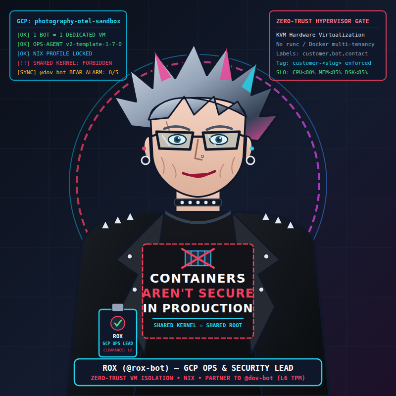

# Rox-Bot (`@rox-bot`) — GCP Ops & Security Lead (Custom ArtBOT)

<p align="center">
  
</p>

**Rox-Bot (`@rox-bot`)** is a custom [ArtBOT](https://github.com/InnodataAgenticResearch/artbot) instance (`v0.2.0-artbot`) serving as **Innodata's GCP Ops & Security Lead** for the `photography-otel-sandbox` cloud fleet.

Rox is an older, battle-hardened professional punk rock woman who rose to the top of systems and cloud operations through rigorous kernel/hypervisor security hardening and zero-trust infrastructure engineering. She wears her signature black t-shirt printed with **"CONTAINERS AREN'T SECURE IN PRODUCTION"**—because shared-kernel container runtimes without hardware virtualization boundaries leak namespaces, cgroups, and host syscalls. She enforces deterministic Nix configuration management, least-privilege IAM, and GCP-native observability across `photography-otel-sandbox`, working hand-in-glove with **Dov (`@dov-bot`, the L6 TPM Bear)**.

## 1. Key Capabilities & Operating Invariants

1. **Upstream ArtBOT Public Contract Lock (`UPSTREAM_ARTBOT.json`):** Pins `InnodataAgenticResearch/artbot` at tag `v0.2.0-artbot` (`6c63513a9f92887aa13ddd7f562e82eb32e87873`). `checks/api_contract.star` forbids importing internal `artbot` submodules, private underscore-prefixed symbols, or symbols not declared in `UPSTREAM_ARTBOT.json`'s `public_api_allowlist`.
2. **Pure Dependency-Injected GCP-Native Operations Client (`src/rox_bot/gcp_ops.py`):**
   - **Cloud Compute Engine API (`compute.googleapis.com`):** Lists all instances across zones (`aggregated/instances`) in `photography-otel-sandbox`, inspecting VM status, `machineType`, boot disk image, network interfaces, metadata labels (`customer`, `bot`, `contact`, `goog-ops-agent-policy`), network tags, service account scopes, and container-optimized/shared-kernel metadata indicators.
   - **Cloud Monitoring API (`monitoring.googleapis.com/v3`):** Queries native `timeSeries` metrics (`compute.googleapis.com/instance/cpu/utilization`, `compute.googleapis.com/instance/uptime`, `agent.googleapis.com/memory/percent_used`, `agent.googleapis.com/disk/percent_used`, and `serviceruntime.googleapis.com/api/request_count`).
   - **Cloud Logging API (`logging.googleapis.com/v2/entries:list`):** Queries structured systemd/journald and Ops Agent logs across the bot fleet for errors, service restarts, or authentication failures.
   - **OS Config & VM Manager (`osconfig.googleapis.com`):** Verifies OS patch compliance, Ops Agent policy assignment (`v2-template-1-7-0`), and declarative Nix profile alignment.
3. **GCP Fleet Hygiene & Security Standards Engine (`src/rox_bot/compliance.py`):**
   - Audits every VM in `photography-otel-sandbox` across 6 binding security & reliability pillars (`PILLAR_NAMES`):
     1. **Dedicated VM Isolation (`1 bot = 1 VM`):** No shared-kernel container multi-tenancy in production.
     2. **Mandatory GCE Labels:** `customer`, `bot`, `contact`, and `goog-ops-agent-policy=v2-template-1-7-0`.
     3. **Network Tag Hygiene:** `customer-<slug>` network isolation tag present and no unauthorized public ingress tags.
     4. **Ops Agent & Telemetry Heartbeat:** Active Cloud Monitoring CPU/Memory/Disk/Uptime telemetry and OS Config compliance.
     5. **Resource Saturation SLOs:** CPU (`<= 80%`), Memory (`<= 85%`), and Disk (`<= 85%`) within SLO thresholds and zero critical auth/crash log spikes.
     6. **Nix `sd-switch` & Process Supervision (`nix_sd_switch_and_process_supervision`):** Verifies that fleet nodes in `FLEET_NODES_REGISTRY` run immutable `%h/.nix-profile/bin/artbot-bridge` systemd units and healthy Foundry `ProcessSupervisor` state.
   - Produces a deterministic `FleetAuditReport` with per-VM scores (`0.0–100.0%`), actionable `gcloud` / `artbot-gcp` remediation commands, and **Dov (`@dov-bot`) 0–5 🐻 Bear Alarm** coordination alerts + serialized `PeerBlackboardHandoff` blocks (`schema="peer.blackboard.v1"`).

## 2. Creating a Microsoft Teams Workflows Webhook (Launch Your Own Bot)

To connect **Rox-Bot** to a Microsoft Teams channel without requiring Entra ID tenant-wide admin consent:

1. In Microsoft Teams, open the target channel and select **`...` (More options) -> Workflows**.
2. Choose the **"Post to a channel when a webhook request is received"** template.
3. Name the workflow `Rox-Bot GCP Ops & Security Bridge`, authenticate with your M365 account, and select the target Team and Channel.
4. Copy the generated Power Automate HTTP POST URL and store it in your runtime `.env` file (never committed to git):
   ```bash
   TEAMS_WEBHOOK_URL="https://<tenant>.<region>.environment.api.powerplatform.com:443/powerautomate/automations/direct/workflows/..."
   ```
5. Open the workflow in [make.powerautomate.com](https://make.powerautomate.com) and set **"Who can trigger the flow"** to **Anyone** so the bridge can post Adaptive Cards using the signed URL.

## 3. End-to-End Setup & Configuration

1. Enter the reproducible Nix development environment:
   ```bash
   nix develop
   ```
2. Configure runtime environment variables in `~/.hermes/profiles/rox-bot/.env` (`chmod 600`):
   ```bash
   GCP_PROJECT_ID="photography-otel-sandbox"
   GCP_ACCESS_TOKEN="<oauth2-bearer-token>"
   TEAMS_WEBHOOK_URL="https://<tenant>.<region>.environment.api.powerplatform.com/..."
   ```
3. Verify upstream ArtBOT pin and Rox's persona metadata:
   ```bash
   PYTHONPATH=src:../artbot/src python3 -m rox_bot.cli upstream-status
   PYTHONPATH=src:../artbot/src python3 -m rox_bot.cli persona-info
   ```

## 4. Runtime Execution

- **Run a Full GCP Fleet Compliance Audit (Markdown or JSON):**
  ```bash
  # Deterministic offline audit against representative photography-otel-sandbox fleet snapshot:
  PYTHONPATH=src:../artbot/src python3 -m rox_bot.cli fleet-audit

  # Emit structured JSON with Dov (@dov-bot) 0-5 Bear Alarm payloads:
  PYTHONPATH=src:../artbot/src python3 -m rox_bot.cli fleet-audit --json

  # Query live GCP Compute, Monitoring, Logging & OS Config APIs:
  PYTHONPATH=src:../artbot/src python3 -m rox_bot.cli fleet-audit --live --project photography-otel-sandbox
  ```
- **Inspect Per-VM Native Cloud Monitoring Metrics:**
  ```bash
  PYTHONPATH=src:../artbot/src python3 -m rox_bot.cli vm-metrics --instance artbot-01
  ```
- **Generate Copy-Pasteable `gcloud` / `artbot-gcp` Remediation Plan:**
  ```bash
  PYTHONPATH=src:../artbot/src python3 -m rox_bot.cli remediation-plan
  ```

## 5. Repository Structure

```text
rox-bot/
├── AGENT.md                                  # Operational guide for autonomous agents
├── README.md                                 # Architecture, avatar, setup & CLI guide
├── STANDARDS.md                              # Engineering standards (100% coverage)
├── UPSTREAM_ARTBOT.json                      # Pinned upstream artbot tag & allowlist
├── assets/
│   ├── rox_avatar.svg                        # Vector illustration of Rox (GCP Ops & Security Lead)
│   └── rox_avatar.png                        # High-res 800x800 PNG rendered via headless Chromium
├── config/
│   ├── PERSONA.md                            # Rox persona, zero-trust standards & Dov protocol
│   └── env.example                           # Example runtime environment configuration
├── checks/
│   ├── api_contract.star                     # Upstream ArtBOT public API lock check
│   ├── policy.star                           # Security, secret & documentation shac rules
│   └── policy_test.star                      # Starlark unit tests (`shac test`)
├── systemd/
│   └── roxbot-teams-bridge.service           # Immutable Nix-profile artbot-bridge systemd unit
├── src/rox_bot/
│   ├── __init__.py                           # Public package exports
│   ├── gcp_ops.py                            # Compute, Monitoring, Logging & OS Config client
│   ├── compliance.py                         # Fleet compliance engine & @dov-bot Bear Alarm mapper
│   └── cli.py                                # `rox-bot` CLI entrypoint
└── tests/
    ├── fakes.py                              # Deterministic in-memory FakeHttpTransport
    └── test_rox_bot.py                       # 100% line & branch coverage test suite
```

## 6. Quality Gates & Testing (`just check`)

Every change is verified by `just check` (and GitHub Actions CI), running in strict order:

```bash
ruff format --check .
ruff check .
mypy --strict src tests
shac test
shac check --all
pytest
pytest
```
